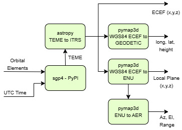

# Orbit Propagator for Tracking Earth's Artificial Satellites in LEO

Satellite orbit propagation and trajectory generation for tracking of space objects—including debris, rocket bodies, and payloads—focusing primarily on artificial satellites in low Earth orbit (LEO).

### Links

- **LinkedIn**: [[linkedin](https://www.linkedin.com/pulse/aplicativo-streamlit-de-m%C3%BAltiplas-p%C3%A1ginas-bil%C3%ADngue-e-guedes-soares-1zi9f)]
- **Medium**: [[medium](https://medium.com/@francisvalg/aplicativo-streamlit-de-multiplas-multilingual-streamlit-app-for-orbital-propagation-and-space-1b7068fd4914)]
- **App**: [[Link1](http://www.orbittracking.duckdns.org/)]
- **App**: [[Link2](https://trajectoryorbitpropag.streamlit.app/)]

# Table of Contents

- [Orbit Propagator for Tracking Earth's Artificial Satellites in LEO](#orbit-propagator-for-tracking-earths-artificial-satellites-in-leo)
    - [Links](#links)
- [Table of Contents](#table-of-contents)
  - [1. Introduction](#1-introduction)
    - [Models and Coordinate Systems](#models-and-coordinate-systems)
    - [Block diagram](#block-diagram)
  - [2. Application Features](#2-application-features)
  - [3. Application Structure](#3-application-structure)
    - [Main Pages:](#main-pages)
    - [Pages with Specific Settings:](#pages-with-specific-settings)
  - [4. Technologies Used](#4-technologies-used)
  - [5. Prerequisites](#5-prerequisites)
    - [Windows](#windows)
    - [Linux (Debian/Ubuntu)](#linux-debianubuntu)
  - [6. Installation](#6-installation)
    - [Installation Script](#installation-script)
    - [Installation - manual](#installation---manual)
  - [7. Usage](#7-usage)
    - [In a server: if necessary redirect port 80 to 8080](#in-a-server-if-necessary-redirect-port-80-to-8080)
  - [8. Project Structure](#8-project-structure)
  - [9. Libraries Used](#9-libraries-used)
  - [10. Contribution](#10-contribution)
  - [11. License](#11-license)
  - [12. Author](#12-author)
  
## 1. Introduction

The software processes orbital elements extracted from Space-Track or Celestrak and, through the SGP4 model, propagates the orbit of space objects. Additionally, it implements coordinate conversions to calculate approximations to the reference point and generate trajectories with an initial instant (H0) for tracking.

### Models and Coordinate Systems

The python implementation of SGP4 (Simplified General Perturbations Model 4) uses orbital elements in the OMM (Orbit Mean-Elements Message) format to predict the position of a satellite at a given time.

The coordinate systems involved include:
- **TEME (True Equator Mean Equinox)**: Orbital reference system associated with OMM elements.
- **ITRS (International Terrestrial Reference System)**: Earth-fixed system, serving as the basis for geodetic coordinates.
- **ECEF (Earth-Centered, Earth-Fixed)**: Earth-centered system fixed relative to its rotation.
- **ENU (East-North-Up)**: Local coordinate system relative to an observer.
- **Geodetic Coordinates (Latitude, Longitude, and Altitude)**: System used to represent positions on Earth's surface.
- **Azimuth, Elevation, and Range**: Sensor pointing representation, with azimuth (horizontal direction), elevation (height above the horizon), and range (target distance).

### Block diagram



## 2. Application Features

The application has the following main features:
- **Reading Orbital Elements**: Imports data from Space-Track and Celestrak.
- **Orbit Propagation**: Uses the SGP4 model to compute the object's orbital trajectory.
- **Coordinate Conversions**: Implements conversion between TEME, ITRS, ECEF, ENU, and geodetic coordinates.
- **Trajectory Generation**: Determines approximation points to the observer and defines tracking instants (H0).
- **Map Visualization**: Uses Folium to display trajectories on interactive maps.
- **Bilingual Interface**: Supports English and Portuguese using gettext.

## 3. Application Structure

The application is organized into different pages, each dedicated to a specific functionality:

### Main Pages:
- 🏠 **Home Page**: Welcome page of the application.
- 0️⃣ **Simplified Configuration - Basic Functions of the APP**: Simplified setup with essential application functions.

### Pages with Specific Settings:
- 1️⃣ **Obtain Orbital Elements**: Acquisition of orbital elements.
- 2️⃣ **Orbit Propagation**: Orbit propagation.
- 3️⃣ **Map Visualization**: Display of trajectories on interactive maps.
- 4️⃣ **Orbital Change/Object Maneuvering**: Orbital modification and object maneuvers.
- 5️⃣ **Selection of Specific Trajectories for Sensors**: Choice of custom trajectory for specific sensors.

## 4. Technologies Used

- **Language**: Python
- **Framework**: Streamlit
- **Libraries**: Pandas, Folium, NumPy, SGP4, Astropy, Pymap3d
- **Internationalization**: Gettext

## 5. Prerequisites  

This project uses [uv](https://docs.astral.sh/uv/) to manage Python and dependencies. uv installs the correct Python version automatically (see `.python-version`), so a system Python is not required.

### Windows  

```powershell
powershell -ExecutionPolicy ByPass -c "irm https://astral.sh/uv/install.ps1 | iex"
```

### Linux (Debian/Ubuntu)  

```bash
sudo apt install curl git
curl -LsSf https://astral.sh/uv/install.sh | sh
```

(The `install.sh` script installs uv automatically if it is missing.)

---  

## 6. Installation

1. Clone this repository:  

```bash  
git clone https://github.com/francisvalguedes/TrajectoryOrbitPropag.git  
cd TrajectoryOrbitPropag  
```  

2. Install the dependencies (creates a `.venv` folder with the exact versions pinned in `uv.lock`):

```bash
uv sync
```

Or, on Linux, run the installation script without sudo:  

```bash  
./install.sh             # install uv (if needed) and the dependencies
./install.sh --service   # also install and start a systemd service (starts on boot)
```

### Managing dependencies

Dependencies are declared in `pyproject.toml` and pinned in `uv.lock` (also used by Streamlit Community Cloud). Commit both files after any change:

```bash
uv add <package>        # add a dependency
uv remove <package>     # remove a dependency
uv lock --upgrade       # upgrade all pinned versions
```

## 7. Usage

```bash  
cd TrajectoryOrbitPropag
uv run streamlit run source/main.py --server.port 8080
```  

Stop with `Ctrl+C`. To run it as a background service on a Linux server, see below.

### Run on boot (Linux server)

The recommended way is the systemd service (instead of a crontab `@reboot` entry): it waits for the network, restarts the app if it crashes and keeps logs in the journal.

```bash
./install.sh --service
systemctl status trajectory-orbit-propag     # status
journalctl -u trajectory-orbit-propag -f     # logs
sudo systemctl restart trajectory-orbit-propag   # restart after updating (git pull && uv sync)
```

Open the link in shel (`http://localhost:8080`).  


### In a server: if necessary redirect port 80 to 8080

with the app running

confirm that the server is running on port 8080

~~~
curl http://localhost:8080
~~~

check active rules in iptables

~~~
sudo iptables -t nat -L PREROUTING -n -v
sudo iptables -L OUTPUT -n -v
~~~

Redirect app port 8080 to web server port 80:

~~~
sudo iptables -t nat -A PREROUTING -p tcp --dport 80 -j REDIRECT --to-port 8080
sudo iptables -I INPUT -p tcp --dport 8080 -j ACCEPT
~~~

test if web server works without specifying port, by typing in browser: my_ip_address. If it works then make the redirect permanent:

~~~
sudo apt-get install iptables-persistent
~~~

if already isntalled then restart it:

~~~
sudo dpkg-reconfigure iptables-persistent
~~~

## 8. Project Structure

```
TrajectoryOrbitPropag/
├─ .streamlit/
│  └─ config.toml
├─ data/
│  ├─ celestrak/
│  │  └─ teste.md
│  ├─ confLocalWGS84.csv
│  ├─ confRadar.csv
│  ├─ norad_id.csv
│  └─ RCS.csv
├─ figures/
│  └─ ...
├─ locales/
│  ├─ pt-BR/
│  │  └─ LC_MESSAGES/
│  │     └─ ...
│  └─ README.md
├─ source/
│  ├─ lib/
│  │  ├─ constants.py
│  │  ├─ orbit_functions.py
│  │  └─ pages_functions.py
│  ├─ pages/
│  │  ├─ 00_Simplified.py
│  │  ├─ 01_orbital_elements.py
│  │  ├─ 02_orbit_propagation.py
│  │  ├─ 03_map.py
│  │  ├─ 04_orbit_compare.py
│  │  └─ 05_trajectory.py
│  └─ main.py
├─ .gitignore
├─ conf.json
├─ get_translate.py
├─ deploy/
│  └─ trajectory-orbit-propag.service
├─ install.sh
├─ LICENSE
├─ localazy.json
├─ README.md
├─ pyproject.toml
└─ uv.lock
```  


## 9. Libraries Used

- SGP4 - MIT License
- Astropy - BSD-3-Clause
- pandas - BSD-3-Clause
- numpy - BSD-3-Clause
- streamlit - Apache 2.0
- pymap3d - BSD-2-Clause
- Geopandas - BSD 3-Clause License
- Folium - MIT License
  
## 10. Contribution

- Contributions are welcome! Feel free to open issues and pull requests.

## 11. License

- This project is licensed under the MIT License. See the LICENSE file for more details.

## 12. Author

- Autor: Francisval Guedes Soares,- 
- Contributions/suggestions from: Felipe Longo, Hareton, André Henrique, Marcos Leal, Leilson, Alan Karlo.
